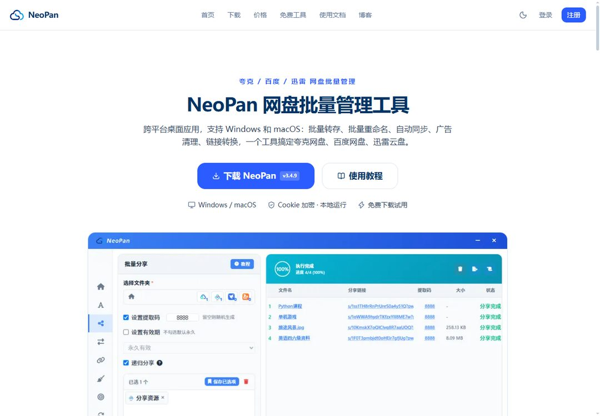

# NeoPan 网盘批量管理工具

**夸克 / 百度 / 迅雷 / UC 网盘一站式批量管理桌面应用**

批量转存 · 批量重命名 · 批量分享 · 链接转换 · 广告清理 · 自动同步 · 网盘搬家 · 跨盘互转 · AI 素材生成

  <strong>4</strong> 大网盘统一管理 · <strong>10+</strong> 个批量功能 · <strong>2</strong> 大 AI 模型 · <strong>30+</strong> 篇官方教程 · <strong>2</strong> 大桌面平台 · 数据本地留存

---

## 目录

- [NeoPan 是什么](#neopan-是什么)
- [界面预览](#界面预览)
- [核心亮点](#核心亮点)
- [功能一览](#功能一览)
- [功能详解](#功能详解)
- [支持的网盘](#支持的网盘)
- [热门搜索场景](#-热门搜索场景)
- [常见问题](#常见问题)

## NeoPan 是什么

**NeoPan** 是一款跨平台桌面应用（Windows / macOS），专为网盘重度用户和资源分享者设计的**网盘批量管理工具**：

- **批量转存**：一键把上百条分享链接转存到自己网盘，智能分批（100→50→25 自动降级），保留目录结构
- **批量重命名**：前缀、后缀、替换、序号多种规则自由组合，批量整理文件名
- **自动同步**：定时任务自动同步分享链接的最新文件，支持增量同步与 1 小时 / 1 天 / 3 天多种周期——自动追更神器
- **网盘搬家**：百度网盘转夸克 / 迅雷、夸克转百度，跨网盘互转批量迁移，边下边传、传完即删，不用手动下载再上传
- **AI 素材生成**：集成 Gemini + DeepSeek 双模型，自动为网盘分享链接生成推广图片和文案，配合 WordPress 自动发布——网盘拉新推广一站式自动化（同类工具尚未提供）

## 界面预览

## 核心亮点

- **AI 驱动网盘拉新推广**：Gemini 与 DeepSeek 双模型自动生成推广文案与图片，结合 WordPress 自动发布，做网盘推广不用再愁素材
- **批量效率翻倍**：上百条链接一键批量转存 / 重命名 / 分享，智能分批自动降级，保留原目录结构
- **跨平台多网盘统一**：Windows 与 macOS 双平台原生支持，夸克、百度、迅雷、UC 统一管理，切换即用
- **安全本地执行**：网盘 Cookie 强加密本地存储，所有操作在本机直接执行，数据不上传服务器

## 功能一览

| 功能 | 说明 | 类型 |
| --- | --- | --- |
| 批量转存 | 上百条分享链接一键转存，智能分批 + 保留目录结构 | 核心 |
| 批量重命名 | 前缀 / 后缀 / 替换 / 序号规则自由组合 | 核心 |
| 批量分享 | 网盘文件批量生成分享链接 | 核心 |
| 链接转换 | 别人的分享链接一键转成自己的，支持 Excel 导入导出 | 核心 |
| 广告清理 | 智能清理广告文件与垃圾文件夹，支持关键词与大小筛选 | 核心 |
| 自动同步 | 定时同步分享链接最新文件，增量同步，支持多周期 | 高级 |
| 网盘搬家 | 四盘任意组合整目录搬移（含同盘跨账号），边下边传、传完即删 | 跨盘 |
| 随机插入文件 | 随机插入广告钩子或联系方式文件，提升曝光转化 | 营销 |
| **后处理** | 转存/同步/链接转换完成后自动执行：重命名 → 清广告 → 插广告 全流水线 | 自动化 |
| AI 素材生成 | Gemini + DeepSeek 生成推广图片与文案（免费功能） | AI |
| 贴吧自动发帖 | 多吧按序自动发帖、支持图片上传（AI 自动推广渠道之一） | 自动化 |
| WordPress 自动发布 | AI 素材一键发布到 WordPress 网站，引流自动化 | 自动化 |
| 文件浏览器 | 四盘通用面板：浏览 / 多账号搜索 / 下载 / 分享 / 删除 | 辅助 |
| 目录树导出 | 网盘目录结构一键导出为树形文本 | 工具 |
| 在线工具集 | 网盘链接有效性检测（10+ 网盘）+ 正则表达式生成器，免登录 | 免费 |

## 功能详解

每项功能都有图文教程（30+ 篇官方文档）：

| 教程 | 内容 |
| --- | --- |
| [批量转存教程](https://app.neopan.cn/docs/batch-transfer-tutorial) | 批量转存分享链接、分批策略、目录结构保留 |
| [网盘搬家 / 跨盘互转](https://app.neopan.cn/docs/netdisk-migration) | 百度网盘转夸克 / 迅雷，跨网盘迁移全流程 |
| [自动同步教程](https://app.neopan.cn/docs/auto-sync-tutorial) | 定时任务、增量同步、追更设置 |
| [链接转换教程](https://app.neopan.cn/docs/link-convert-tutorial) | 分享链接转自己的链接，批量 + Excel |
| [广告清理教程](https://app.neopan.cn/docs/ad-cleaner-tutorial) | 广告文件识别、关键词与大小筛选、批量删除 |
| [批量重命名](https://app.neopan.cn/docs/batch-rename) | 多规则组合批量改名 |
| [AI 自动推广教程](https://app.neopan.cn/docs/ai-auto-promotion-tutorial) | AI 素材生成 + WordPress 自动发布 |
| [后处理教程](https://app.neopan.cn/docs/post-processing-guide) | 转存后自动重命名 → 清广告 → 插广告 流水线 |
| [批量分享教程](https://app.neopan.cn/docs/batch-share-tutorial) | 批量生成分享链接和提取码，统一有效期 |
| [文件浏览器](https://app.neopan.cn/docs/file-browser-guide) | 四盘通用文件面板：搜索 / 下载 / 分享 / 删除 |
| [导出目录树](https://app.neopan.cn/docs/export-directory-tree-guide) | 目录结构一键导出树形文本 |
| [多网盘管理](https://app.neopan.cn/docs/multi-cloud-management) | 四网盘多账号统一添加与切换 |
| [下载安装快速上手](https://app.neopan.cn/docs/download-install-quickstart) | 从下载到第一个批量任务 |

完整文档目录见 [app.neopan.cn/docs](https://app.neopan.cn/docs)。

## 🔄 网盘互转 / 跨盘搬家详解

「百度网盘转存其他网盘」在 NeoPan 里对应**三个功能**，先选对再动手（选错会多干活）：

| 你要做的事 | 用哪个 | 结果 |
| --- | --- | --- |
| 别人的分享链接，存进自己另一个盘 | 批量转存 → **跨网盘转存** | 文件落进目标盘，不生成新链接 |
| 别人的链接，换成自己盘的链接再发出去 | 链接转换 → **跨网盘转换** | 存进目标盘 + 自动生成你的新分享链接 |
| 自己一整个文件夹换盘 | **网盘搬家** | 目标盘出现同一份目录（含所有子文件夹） |

**支持范围**

- 按文件夹搬家：**夸克 / 百度 / 迅雷 / UC 任意组合**，也支持同网盘跨账号（小号资源挪大号）
- 按分享链接转存 / 转换：只认**夸克 / 百度 / 迅雷**三种链接（UC 链接暂不支持，UC 资源走搬家）

**技术特点**

- **边下边传、传完即删**：夸克 / UC 作目标走流式（取一片传一片）；百度 / 迅雷目标先下到临时目录分批滚动，本地最多堆一批 + 512MB 缓冲，不会撑爆硬盘
- **多目标复用一次下载**：一份源文件搬去几个盘，只下载一次再分别上传（一次最多勾 3 个目标盘）
- **失败可重试**：整批跑完后只重跑失败的目标行，支持暂停 / 继续 / 停止，任务结果可导出
- **凭据本地加密**：Windows 用 DPAPI、macOS 用钥匙串，传输全程在你电脑与网盘之间直连，不经任何第三方服务器——这也是本地中转对比「云端直转服务」的安全优势

**前提与限制**：跨盘三功能需要会员权限；百度作源盘需 Cookie 登录（仅开放平台授权不能转存他人分享）；百度作目标需完成开放平台授权；不支持转存自己创建的分享；不支持阿里 / 天翼 / 123 云盘。完整操作步骤与报错排查见[网盘搬家教程](https://app.neopan.cn/docs/netdisk-migration)与[互转实战博客](https://app.neopan.cn/blog/cross-netdisk-transfer)。

## 支持的网盘

| 网盘 | 登录方式 | 批量转存 | 链接转换 | 广告清理 |
| --- | --- | --- | --- | --- |
| **夸克网盘** | Cookie 配置 | ✅ | ✅ | ✅ |
| **百度网盘** | 账号配置 | ✅ | ✅ | ✅ |
| **迅雷云盘** | App 扫码登录 | ✅ | ✅ | ✅ |
| **UC 网盘** | 账号配置 | ✅ | — | — |

## 🔍 热门搜索场景

NeoPan 覆盖这些高频网盘操作需求：

- **百度网盘转存其他网盘** / **百度网盘转夸克网盘**：[跨盘转存](https://app.neopan.cn/docs/netdisk-migration)存资源不生成链接，[网盘搬家](https://app.neopan.cn/docs/netdisk-migration)整目录搬移，边下边传、传完即删
- **夸克转百度 / 同盘跨账号**：夸克链接转存到百度（目标需开放平台授权），小号资源一键挪大号
- **网盘自动同步 / 自动追更**：[定时同步任务](https://app.neopan.cn/docs/auto-sync-tutorial)，分享链接更新自动增量同步
- **批量转存分享链接**：[上百条链接](https://app.neopan.cn/docs/batch-transfer-tutorial)一键转存，智能分批不封号
- **网盘链接转换**：把别人的夸克 / 百度 / 迅雷分享链接转成自己的，支持批量与 Excel
- **网盘广告文件清理**：批量删除广告文件与垃圾文件夹
- **网盘批量重命名**：多规则组合批量改名
- **网盘拉新推广**：[AI 自动生成推广素材](https://app.neopan.cn/docs/ai-auto-promotion-tutorial) + 贴吧自动发帖 + WordPress 自动发布
- **网盘分享链接失效检测**：[免费在线链接检测工具](https://app.neopan.cn/tools/disk-check)，10+ 网盘批量粘贴免登录
- **转存后自动整理**：[后处理](https://app.neopan.cn/docs/post-processing-guide)一次配置，重命名 / 清广告 / 插广告全自动
- **网盘资源批量下载 / 网盘互转方法对比**：见[官方博客](https://app.neopan.cn/blog)实战文章

## 常见问题

**NeoPan 支持哪些网盘？**
夸克网盘、百度网盘、迅雷云盘、UC 网盘，一个工具统一管理。

**NeoPan 是免费的吗？**
基础功能**免费**（批量转存 / 重命名 / 分享 / 广告清理 / 插入 / AI 素材生成）。进阶功能需会员：VIP1 ¥25/月，VIP2 ¥30/月（自动同步高级 + AI 全家桶），永久版 ¥360 买断，详见[定价页](https://app.neopan.cn/pricing)。

**NeoPan 自己有推广返佣吗？**
有。[推广返佣计划](https://app.neopan.cn/blog/neopan-referral-commission-program)最高 **50%** 佣金（普通会员 40% / 专业版 50%），被推广用户后续续购持续返佣，佣金满 10 元即可提现，2-3 小时内到账。

**NeoPan 安全吗？**
Cookie 与账号信息强加密本地存储，所有操作在本机执行，数据不上传服务器。

**与手动操作比快多少？**
上百条分享链接的批量转存，手动要几小时，NeoPan 一次批量完成（实测 128 条链接 47 秒）。

## 🔄 版本里程碑

- **v3.4.7** —— 批量分享支持按层级递归分享，迅雷广告插入恢复
- **v3.4.6** —— **跨盘能力重新上线**：网盘搬家 / 跨网盘转存 / 跨网盘链接转换三模块
- **v3.4.5** —— **新增 UC 网盘支持**，链接转换去重缓存
- **v3.1.7** —— **应用内在线更新**，DeepSeek v4 flash 支持
- **v3.1.6** —— **新增迅雷云盘支持**，百度批量下载与上传
- **v3.1.0** —— **多网盘账号体系**，百度网盘自动同步上线
- **v2.5.5** —— **基础功能免费开放**，AI 素材一键发布 WordPress

完整更新日志见[文档中心](https://app.neopan.cn/docs)。

## 相关链接

- [官方网站](https://app.neopan.cn/)
- [下载客户端](https://app.neopan.cn/download)（Windows / macOS）
- [使用文档（30+ 篇）](https://app.neopan.cn/docs)
- [定价](https://app.neopan.cn/pricing)
- [网盘玩法博客](https://app.neopan.cn/blog)
